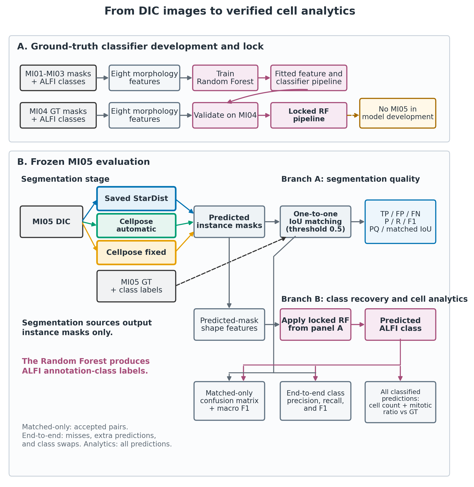
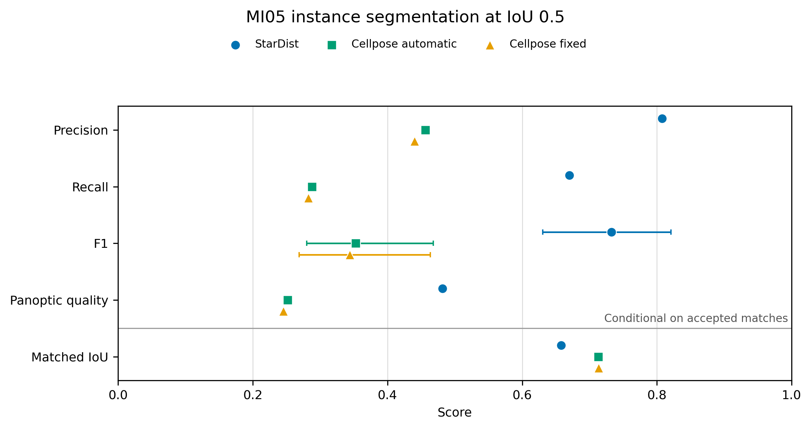

# StarDist vs Cellpose on DIC microscopy

**Numerical Evaluation of Cell Segmentation Methods: a Comparison between StarDist and Cellpose in DIC Microscopy**

Bachelor's thesis in Data Analytics, Università degli Studi della Campania "Luigi Vanvitelli", 2026.
Research internship at CNR-ICAR (Naples).
Supervisor: Prof. Rosanna Campagna · Co-supervisor: Dr. Laura Antonelli

    

## What this project does

Label-free DIC time-lapse images of human cells (ALFI dataset) are segmented with two deep-learning tools. Each detected cell is then classified as **interphase** or **mitotic**. The project asks:

> Which tool gives better cell counts and mitotic ratios, and how do segmentation errors travel into the final cell analytics?

1. **Prepare the data.** Convert the ALFI masks and fix a label-overflow bug that erased every mitotic cell.
2. **Segment.** Train StarDist 2D (MI01–MI03, validation MI04) and run pretrained Cellpose `cyto3` (automatic diameter and fixed 38.5 px).
3. **Classify.** A Random Forest on 8 shape features, trained once and used for every method.
4. **Evaluate.** One evaluator for all methods on the held-out sequence MI05: IoU ≥ 0.5 matching, F1, panoptic quality, moving-block bootstrap and IoU sensitivity.
5. **Trace the errors.** Follow segmentation errors into cell counts and mitotic ratios.



## Main results (MI05 test sequence)

| Method | Precision | Recall | Detection F1 | PQ | Matched IoU |
|---|---|---|---|---|---|
| **StarDist** | **0.808** | **0.670** | **0.733** | **0.482** | 0.658 |
| Cellpose automatic | 0.456 | 0.288 | 0.353 | 0.252 | 0.713 |
| Cellpose fixed | 0.440 | 0.282 | 0.344 | 0.246 | **0.714** |

StarDist finds about twice as many cells. Cellpose outlines the cells it finds slightly more tightly, but it misses most of them. Full numbers: [`comparison_summary.csv`](evaluation/results/verified/comparison_summary.csv).



## Repository structure

```
internship/    data preparation, StarDist training, Cellpose runs, trained StarDist model
evaluation/    unified evaluation, statistics, figures, unit tests, verified results
docs/figures/  figures used in this README
```

Each folder has its own README with full details.

## Quick start

```bash
conda env create -f evaluation/environment/cellproject.environment.yml
conda activate cellproject
cd evaluation
python -m unittest discover -s code/tests -v
```

To rerun the full evaluation, download the ALFI data, prepare it with the `internship/` scripts, and set `dataset_root` in `evaluation/code/configs/`.

## Data

ALFI dataset: Antonelli et al., *Scientific Data*, 2023. The images are **not** included in this repository. Download them here:
https://springernature.figshare.com/collections/ALFI_Cell_cycle_phenotype_annotations_of_label-free_time-lapse_imaging_data_from_cultured_human_cells/6436958/1

## Tech

Python · StarDist / TensorFlow · Cellpose / PyTorch · scikit-learn · scikit-image · pandas · matplotlib · LaTeX

## Limitations

- All test results come from one sequence (MI05), whose frames are not independent.
- The classifier uses shape features only, so it cannot see intensity or texture.

## Author

**Marjan Rafiei** · [LinkedIn](https://www.linkedin.com/in/marjan-rafiei)
